# Tameru

**Tameru moves irrigation pumping, not irrigation, so farms keep watering when the grid is short.**

By **Mottainai Studio**, KIZUNA 2026 (Hackathon ESPRIT × Japan).

**Links:** website [link] · demo video [link] · pitch deck [link]

`KIZUNA 2026` · `MIT licence` · **All results in this repository are simulated** (a synthetic Cap Bon district
on real weather). They are not field measurements. Real facts (the STEG shedding calendar, STEG tariffs, weather)
are marked *real* and each one has a source link.

---

## 1. The problem (real)

- **Summer 2026 was Tunisia's hottest since 1950**, according to the national weather institute INM
  ([allAfrica, 22 Sep 2026](https://fr.allafrica.com/stories/202609220426.html)).
- **STEG cut power in rotation.** To avoid a national blackout, STEG ran rotating load shedding. We documented
  **28 announced windows on 22 days** between 16 July and 3 September 2026, from STEG announcements relayed by
  the Tunisian press, one source link per window in
  [`results/shedding_calendar_2026.csv`](results/shedding_calendar_2026.csv). Nabeul / Cap Bon was on the lists.
- **The notices came late.** **19 of 25** dated notices were published at or after the window had started. A
  farm or a village cannot plan on them.
- **National supply was short of peak demand.** STEG's CEO put the July peak at about 5,000 MW
  ([TAP via allAfrica, 16 Jul 2026](https://fr.allafrica.com/stories/202607160372.html)); the press reported
  about 4,300 MW of available production (Le Temps, 26 Jul 2026), and a deputy 4,500 MW
  ([webdo, 28 Jul 2026](https://www.webdo.tn/fr/?p=401742)).

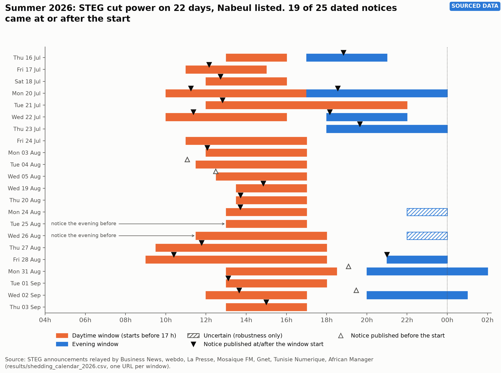

*Real calendar: 28 announced windows on 22 days (STEG announcements via the press; sources in the CSV).*

## 2. The idea

Cap Bon farms already have tanks (*jabia*): the pump fills the tank, and the field is irrigated from the tank,
often by gravity. So **pumping time is not irrigation time**.

Tameru pumps into the tank when the grid is fine, and stops the pump when the grid is short. The field is
irrigated from the tank at the farmer's usual time. Irrigation times don't change; only the pumping moves.

## 3. How it works

**The AI pipeline in three steps.** (1) A forecaster predicts the village's electricity load, (2) an
optimizer decides when each pump runs so the line stays under its capacity, and (3) an anomaly detector checks
that the tank levels match what the pumps did.

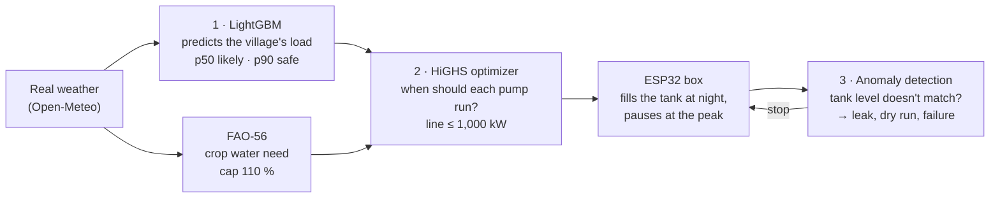

**The control loop.** The box reports back every few seconds, the plan is redone every hour, and the box keeps
working on its own if the link is lost.

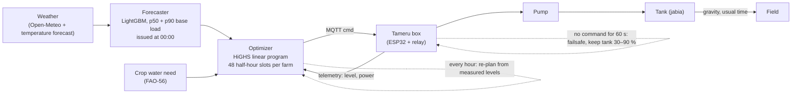

**The district (simulated).** A synthetic Cap Bon district: 200 farms and 1,000 homes on one 1,000 kW rural
feeder, simulated over 730 days (Nov 2024 to Oct 2026) at 15-minute resolution, on real hourly weather from
[Open-Meteo](https://open-meteo.com/) (CC BY 4.0) for the grid point 36.68 N, 10.58 E. The load model (v2)
has household air conditioning driven by lagged temperature, household lighting after sunset, services and
random spikes, and five pumping habits (early morning, split, daytime pre-fill, evening, night pre-fill). The
generator is standard-library Python and deterministic for a given seed. Without Tameru, the feeder's peak
window is 19:00-22:00.

**How water and electricity are linked.** The crop need comes from the FAO-56 formula: (Kc × ET0 − effective
rain) / application efficiency, turned into m³ per farm and per day. Each pump has a power (kW) and a flow
(m³/h), so every m³ pumped costs a known number of kWh. The tank is the buffer between the two: it lets the
pumping happen at a different time from the irrigation. A water budget caps daily pumping at 110 % of the
FAO-56 need (and never below the need), so moving the pumping never turns into over-pumping.

**The forecaster.** A LightGBM model forecasts the feeder's non-pump load (homes, AC, services) day-ahead at
00:00, as a median (p50) and a calibrated upper band (p90). It only uses information known at 00:00 (the
temperature forecast, lags of at least one day). The planner plans against the p90, so a hot evening that comes
in above the median doesn't overload the feeder. Pumping itself is not forecast: it is what Tameru controls.

**The optimizer.** A linear program solved with HiGHS (`scipy.optimize`), with 48 half-hour slots per farm,
re-planned every hour from the measured tank levels. Constraints:
- the crop's water need is met at the farmer's usual irrigation times;
- each tank stays between its 15 % reserve and full;
- at most 3 pump starts per day, and runs of at least 1 h;
- the feeder stays under its capacity, using the p90 forecast as the margin;
- on days the risk flag raises, pumping avoids the forecast risk hours.

The objective is the lowest feeder peak first, then the lowest pumping cost under STEG's real three-period
tariff. The live mode rounds the linear program into whole pump runs (`lp_round`, under a second per plan); an
exact MILP is kept as a reference.

**Safety and diagnosis.** The box keeps its own rules: a float switch stops the pump when the tank is full,
the reserve rule runs it if the tank would fall below the reserve, and if no command arrives for 60 s it keeps
the tank between 30 % and 90 % on its own. Irrigation never depends on the link. On the server, an anomaly
detector compares water and energy balances (tank level change vs pumped flow and pump power) and runs a
CUSUM test for slow leaks, to catch leaks, dry running, pump failures, stuck sensors and lost links. On the test
summer, with simulated faults at assumed rates, it had a precision of 81 % and found 64 % of the faults that
the telemetry could show, with 0.44 false alarms per 100 farm-days (simulated).

**The shedding mode.** Tameru flags risky days from its own day-ahead forecast (forecast maximum temperature
≥ 38 °C): on those days, equipped farms pre-fill their tanks and keep pumping out of the forecast risk hours.
It needs no notice from STEG. STEG's real calendar is used only as the ground truth for the evaluation.

## 4. Results (simulated)

All lines below are simulated. "Adoption" is the share of the 200 farms with a Tameru box.

| Result | Without Tameru | With Tameru | Basis | Adoption |
|---|---|---|---|---|
| Feeder outage hours on the 22 real shedding days | 20.25 h | 11.75 h | 22 shedding days, national gap 14 % | 50 % |
| Feeder outage hours on the 22 real shedding days | 20.25 h | **7.25 h** | same | 70 % (target) |
| Shedding days with no cut left on our feeder | – | 8 of 22 | 22 shedding days | 70 % |
| Household-hours without power avoided | – | 13,000 | 22 shedding days, 1,000 homes | 70 % |
| Unmet crop water need on the shedding days | 95 m³ | 0 m³ | 22 shedding days | 50 % |
| Share of the STEG-notice benefit Tameru gets alone | – | 97 % / 96 % | 22 shedding days | 50 % / 70 % |
| Local feeder peak, worst day (22 Jul 2026) | 1,156 kW | 978 kW | worst test day vs worst | 50 % |
| Local overload, whole test summer | 16 days, 27.75 h | 0 days, 0 h | 153 test days | 50 % |
| Equipped farms' pumping in STEG's 19–23 h peak | 26.5 % | 7.9 % | 20 highest-load test days | 50 % |
| Bill change per equipped farm (median, tax incl., budget enforced) | – | 32.05 TND saved over 20 days; 3 of 94 bills go up | 20 highest-load test days | 50 % |
| Water saved with the 110 % budget (conservative) | – | 395 m³/day (up to 1,418) | 20 highest-load test days | 50 % |
| Pumping vs today, budget enforced | – | −4.6 % | 20 highest-load test days | 50 % |

"With STEG notices" (mode B) means Tameru also gets each announced window from its publication time: outage
11.5 h (50 %) and 6.75 h (70 %). Tameru alone gets almost all of that. The national gap of 14 % is an
assumption, tested from 10 % to 25 % (at 25 %: 37.25 h without Tameru, 28.5 h with it at 50 %).

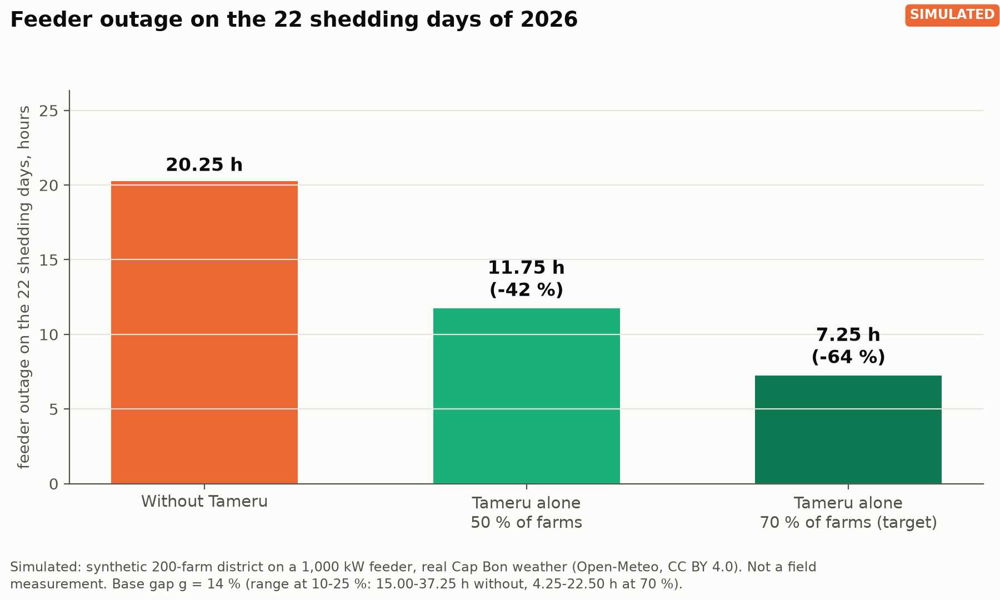

*Simulated. Feeder outage hours on the 22 documented shedding days, without Tameru and with Tameru alone.*

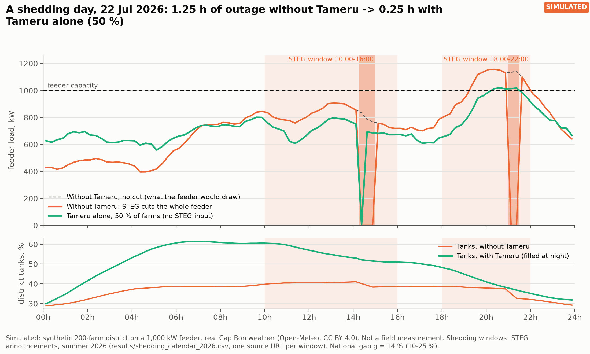

*Simulated. 22 July 2026: feeder load without and with Tameru, with STEG's announced windows.*

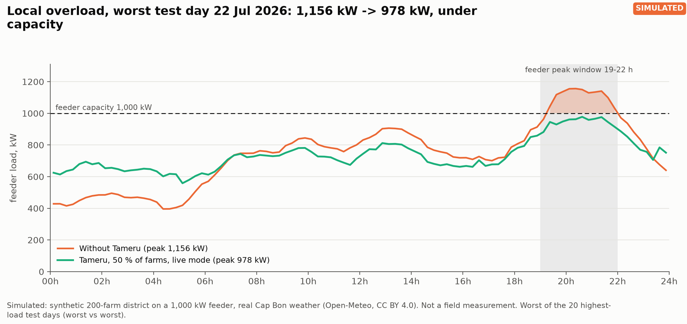

*Simulated. Worst test day on the local feeder, 1,156 kW without Tameru, 978 kW with it (50 %).*

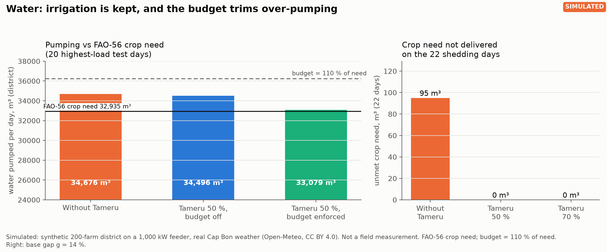

*Simulated. Crop need, water budget and pumping, with and without Tameru.*

### Model performance (simulated test summer, Jun–Oct 2026)

| Model | Metric | Value |
|---|---|---|
| Forecaster (LightGBM) | Error of the median forecast (MAE / MAPE) | 26.2 kW / 7.6 % |
| Forecaster | Error in the feeder peak window 19-22 h (MAPE) | 7.1 % |
| Forecaster | Better than "same as yesterday" / "same day last week" | 7.0 % / 43.0 % |
| Forecaster | Share of hours under the p90 band (target 90 %) | 89.4 % |
| Forecaster | p90 coverage on hot days, 19-22 h | 99.5 % |
| Optimizer (HiGHS) | Worst-day feeder peak, 50 % equipped | 1,156 → 978 kW |
| Anomaly detector | Precision / recall on observable faults | 81 % / 64 % |
| Anomaly detector | False alarms | 0.44 per 100 farm-days |

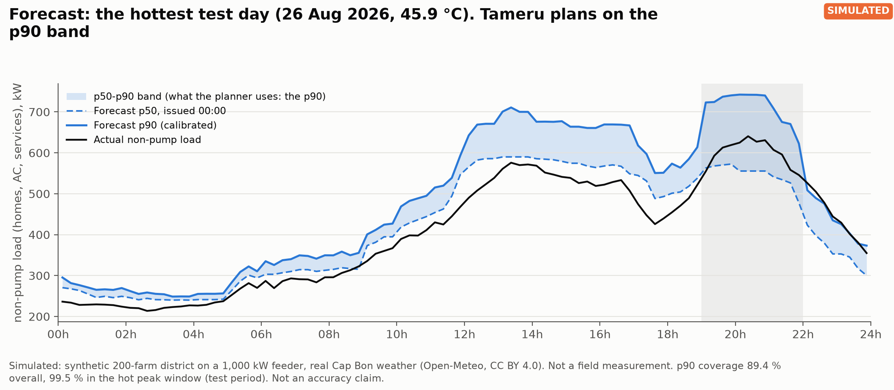

*Simulated. The hottest test day (26 Aug 2026, 45.9 °C): actual non-pump load vs the day-ahead p50 and the p90
band the planner uses.*

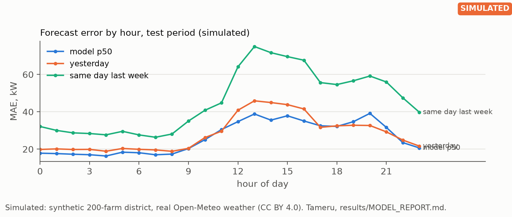

*Simulated. Forecast error by hour on the test summer, against "same as yesterday" and "same day last week".*

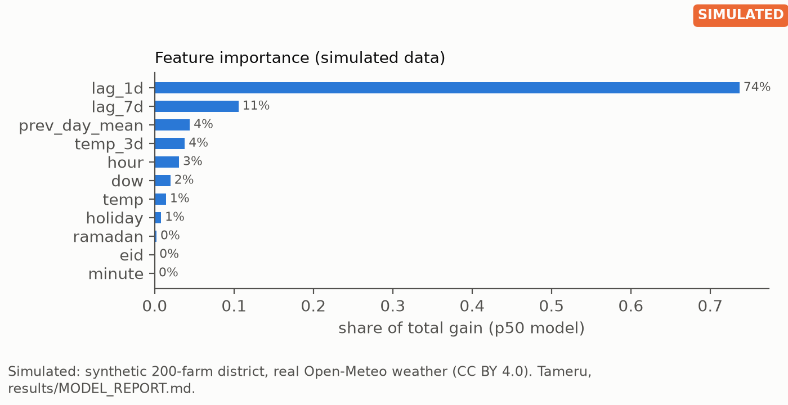

*Simulated. Share of the total gain per feature, p50 model.*

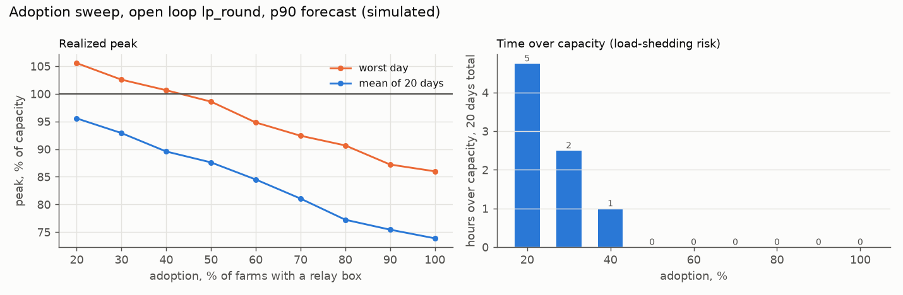

*Simulated. Hours above capacity and shedding outage hours as more farms are equipped.*

## 5. How we evaluated

- **Time-based split:** training Nov 2024 – Apr 2026, validation May 2026, test Jun – Oct 2026 (153 days).
- **The generator was frozen before any model ran on its data**, and every choice (forecaster settings, margin,
  detector thresholds, shedding design) was made on training days only.
- **The test summer was evaluated once**, with acceptance rules fixed in advance. Git tags mark each step:
  `v2-pre-test` (frozen) → `v2-test-eval` (single evaluation); `shed-pre-test` → `shed-test-eval` for the
  shedding scenario.
- **Why load model v2.** The first load model (v1, tag `data-v1`) had no afternoon air-conditioning peak, and
  its evening overload came mostly from assumed farmer pumping habits on top of one household peak. Load model v2
  adds air conditioning, lighting after sunset and five pumping habits, and was checked against realism targets
  (`tameru_data/load_checks.py`) before any model was trained on it.

## 6. Limits

- **The district is simulated.** The farms, homes and feeder are synthetic; only the weather and the shedding
  calendar are real. Real feeder data must retrain and re-score the whole pipeline.
- **Most of the gain comes from normal planning.** The ordinary hourly loop already avoids 7.5 h of outage at
  50 %; the shedding mode adds about 1.0 h.
- **Afternoon cuts are hard.** Little pumping happens in the afternoon, so there is little to move: daytime
  outage goes from 16.0 h to 9.75 h (50 %) and 6.25 h (70 %), evening outage from 4.25 h to 2.0 h and 1.0 h.
- **70 % adoption is the target.** At 50 %, pumping pushed out of the risky hours briefly overloads the local
  line inside the windows on 20–22 July (105 min, up to 1,019 kW). At 70 % this doesn't happen (0 min).
- **The risk flag misses cooler days.** It uses temperature only: 13 hits, 9 misses (cooler August and
  September days, when the supply gap outlasted the heat) and 12 false alarms.
- **The national gap is an assumption.** Only the 5,000 MW demand is a STEG figure; the supply figures come from
  the press and a deputy.
- **The no-Tameru cuts are conservative.** We model one cut of 30 to 90 min per window; residents reported
  longer cuts.
- **The fast planner leaves tanks slightly lower than the exact solver:** 22-38 m³ less water in the district's
  tanks at the end of the day than the MILP (objective 2.3-8.0 % worse); the hourly re-plan catches most of it up.
- **The forecaster is only a little better than "same as yesterday"** (7 % lower error on the test summer); its
  value is the calibrated p90 band (89.4 % coverage), which the planner uses.

## 7. Business model (proposal)

These are proposals, not agreements.

- **STEG pays for flexibility.** Every kW Tameru keeps out of the peak is a kW STEG doesn't have to cut. STEG's
  real BT irrigation tariff already prices the evening peak at 3.4 times the night rate (day 140, peak 391,
  night 116 mill/kWh before tax, in force since 1 May 2022;
  [STEG tariffs](https://www.steg.com.tn/fr/page/les-tarifs-d%C3%A9lectricit%C3%A9),
  [FIPA, Jan 2025](https://investintunisia.tn/wp-content/uploads/2025/01/Couts-des-facteurs-FIPA-FR-Janvier-2025-1.pdf)).
  A critical-peak rebate for shedding days is our proposal; its parameters are assumptions.
- **The GDA (farmers' water association) installs and operates** the boxes on its perimeter.
- **The CRDA (regional agriculture office) validates the water budgets** (110 % of the FAO-56 need).
- **The farmer gets a cheap box and modest savings** (32.05 TND median over 20 hot days, simulated), plus water
  kept in the tank during outages. The main value is fewer outages and water saved, not the bill.
- **Pilot:** one GDA perimeter in Cap Bon, with the utility's real feeder data.

## 8. Repository layout

```
README.md                 this file
LICENSE                   MIT
requirements.txt          pinned Python dependencies for tameru_data/
tameru_data/              pipeline: generate_db, load_checks, features, forecast, optimizer, backtest,
                          water_budget, anomaly, tariff, shedding, choices_v2, report, export_site,
                          site_figures, dashboard_data, check_site, tests; weather_cache.json (Open-Meteo)
results/                  evaluated results (CSV/JSON, run logs), MODEL_REPORT.md/.html, results/figures/
deliverables/             pitch_numbers.md, dashboard_contract.md, brand/ (logo sketches)
deliverables/website/     site_data.json (every number), copy.md, PROJECT_REPORT.md, figures/ (+ INDEX.md), charts/
dashboard/                decision-makers' dashboard (Vite + React + TypeScript), source only
twin/index.html           3D digital twin with a guided demo (illustrative, own simplified simulation)
hardware/                 IoT contract for the Tameru box (MQTT topics, payloads, failsafe) + prototype photo
```

Not in the repository (rebuilt locally): `tameru_data/tameru.db`, `models/`, `node_modules/`, dashboard builds.

## 9. Quick start (Windows PowerShell, from the repository root)

Tested on Windows 11 with Python 3.13.

```powershell
py -3.13 -m venv .venv
.\.venv\Scripts\Activate.ps1
pip install -r requirements.txt
cd tameru_data
python generate_db.py          # ~5 s: rebuilds tameru.db (deterministic, seed 20261112)
python test_optimizer.py       # ~10 s: optimizer invariants
python test_tariff.py          # ~1 s: tariff periods and bills
python load_checks.py          # ~2 s: realism targets of the load model, feeder peak window
```

Full pipeline, in order. The committed `results/` are the single test evaluation; the evaluation steps refuse
to overwrite them unless you pass `--force`.

```powershell
python forecast.py --tune              # ~5 min: rolling-origin CV on train + validation, writes models/
python forecast.py                     # ~1 min: single test evaluation of the forecaster (guarded)
python backtest.py                     # ~36 min: 20 highest-load test days, all scenarios
python backtest.py --whole-period      # ~10 min: every test day, without Tameru and live mode 50 %
python water_budget.py                 # ~11 min: water budget on training days
python anomaly.py --calibrate          # ~3 min: detector thresholds on training days
python anomaly.py --evaluate           # ~5 min: single test evaluation (guarded)
python shedding.py --check             # invariants on a training day
python shedding.py --eval              # ~3 min: shedding scenario, single run (guarded)
python dashboard_data.py               # ~11 min: results/ CSV + JSON for the dashboard
python report.py                       # ~3 s: results/MODEL_REPORT.md/.html + figures
python export_site.py                  # ~2 s: deliverables/website/site_data.json + charts
python site_figures.py                 # ~7 s: website figures + figures/INDEX.md
python check_site.py                   # consistency checks (numbers, figures, README)
```

**Dashboard** (from `dashboard/`, needs Node.js):

```powershell
npm install
npm test                 # unit tests
npm run dev              # http://localhost:5173
npm run build:single     # dist-single/dashboard.html, opens by double-click
```

The dashboard's bundled data (`dashboard/src/data/`) still comes from load model v1. The v2 re-export
(`npm run data`, see [`dashboard/README.md`](dashboard/README.md)) and rebuild are pending. Until then, quote
numbers from `deliverables/website/site_data.json` only.

**3D twin:** open [`twin/index.html`](twin/index.html) in a browser (it loads three.js and Chart.js from a CDN).
It is an illustrative animation with its own simplified simulation; its on-screen numbers are not the backtest
results.

## 10. Hardware / IoT contract

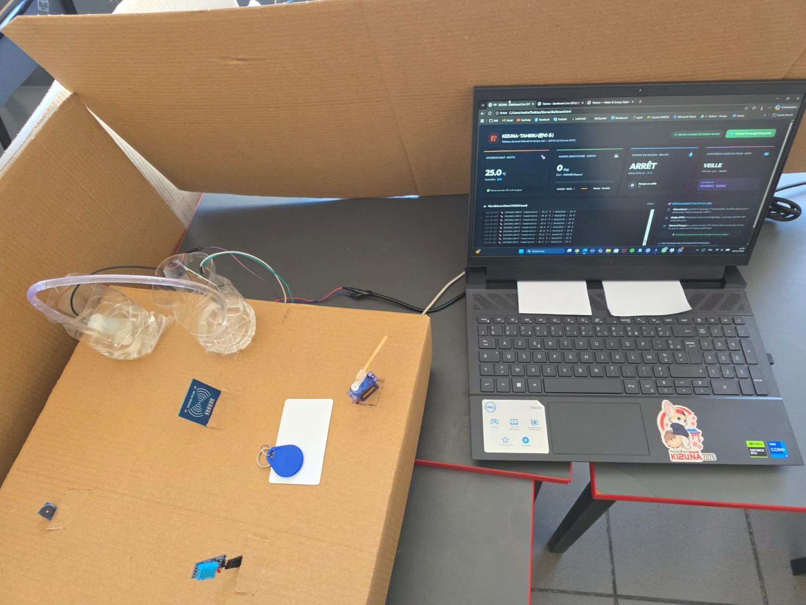

*The hackathon prototype: an ESP32 connected to the laptop (serial, 115,200 baud), a DHT11 temperature and
humidity sensor, a servo for the gravity valve, an RFID reader with badges for the farmer's control, a buzzer, and
a small pump moving water between two containers that stand in for the well and the tank. The laptop shows the
live telemetry dashboard.*

Each farm's box speaks MQTT:

| Topic | Direction | Payload |
|---|---|---|
| `tameru/farm/{id}/telemetry` | box → server | `{"level_pct", "pump_on", "power_w"}` |
| `tameru/farm/{id}/cmd` | server → box | `{"pump": "on" \| "off", "until", "reason"}` |

Failsafe: if no command arrives for 60 s, the box keeps the tank between 30 % and 90 % on its own. The float
switch and the reserve rule always run locally. Optional extensions: a retained 48-slot schedule, ack, status
(last will) and event topics. Details: [`hardware/README.md`](hardware/README.md).

## 11. Sources and credits

Real facts used in this project:

- INM, summer 2026 hottest since 1950: [allAfrica, 22 Sep 2026](https://fr.allafrica.com/stories/202609220426.html)
- STEG shedding announcements, summer 2026: one link per window in
  [`results/shedding_calendar_2026.csv`](results/shedding_calendar_2026.csv) (Business News, webdo, La Presse,
  Mosaïque FM, allAfrica and others), for example
  [Business News, 25 Aug 2026](https://businessnews.com.tn/2026/08/25/la-steg-previent-des-delestages-a-partir-de-mercredi/1415492)
- Peak demand and supply, July 2026: [TAP via allAfrica, 16 Jul 2026](https://fr.allafrica.com/stories/202607160372.html),
  [webdo, 28 Jul 2026](https://www.webdo.tn/fr/?p=401742), Le Temps (26 Jul 2026)
- STEG BT tariffs: [STEG tariffs page](https://www.steg.com.tn/fr/page/les-tarifs-d%C3%A9lectricit%C3%A9),
  [FIPA, Coûts des facteurs, Jan 2025](https://investintunisia.tn/wp-content/uploads/2025/01/Couts-des-facteurs-FIPA-FR-Janvier-2025-1.pdf)
- Weather: [Open-Meteo](https://open-meteo.com/) historical weather API, CC BY 4.0 (cached in
  `tameru_data/weather_cache.json`)
- Crop water need: Allen et al., FAO Irrigation and Drainage Paper 56 (FAO-56), *Crop evapotranspiration*,
  [FAO, 1998](https://www.fao.org/4/x0490e/x0490e00.htm)
- Over-pumping risk with cheap energy: Closas & Rap (2017), *Solar-based groundwater pumping for irrigation*,
  Energy Policy ([record](https://agris.fao.org/search/ar/records/65df245763b8185d9cab0e17))
- Grid emission factor (side note only): IFI Dataset of Default Grid Factors v2.0, 2019
  ([UNFCCC](https://unfccc.int/sites/default/files/resource/Harmonized_Grid_Emission_factor_data_set.pdf))

Software: NumPy, SciPy (HiGHS), pandas, LightGBM, joblib, Matplotlib; the dashboard uses Vite, React and
Chart.js; the twin uses three.js and Chart.js.

## 12. Team: Mottainai Studio

- **Rayan Rejeb**
- **Racem Hannachi** 
- **Yassine Hadded** 
- **Ines Hassene** 

School / programme: Esprit 


