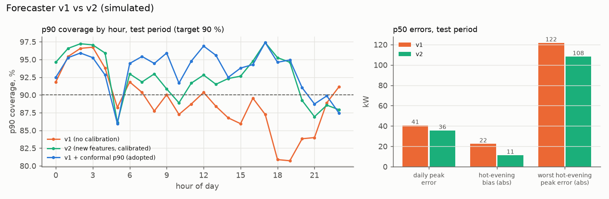
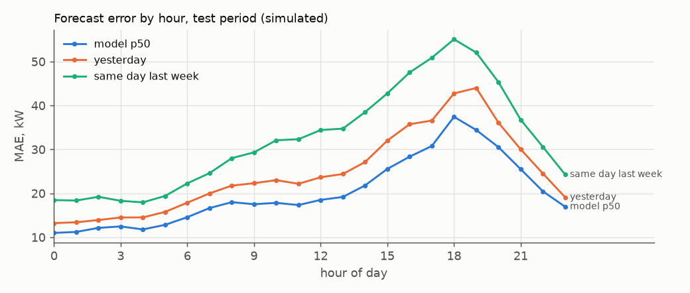
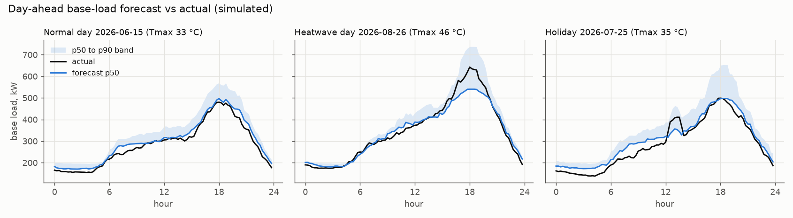
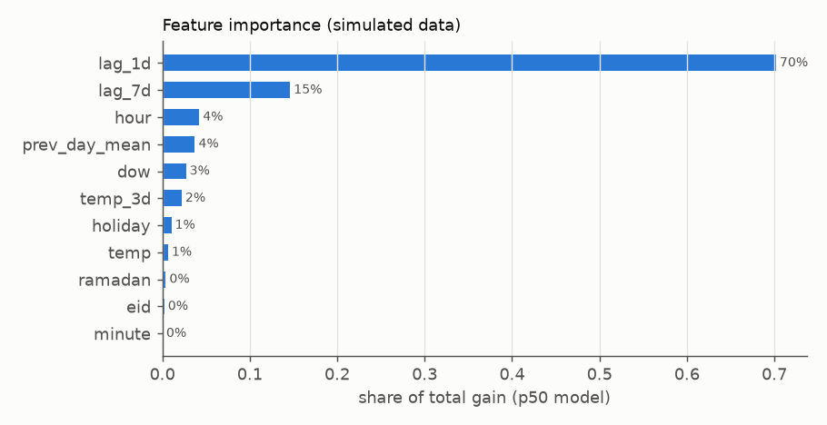
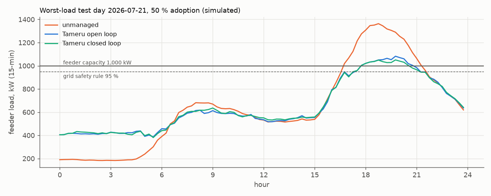

# Tameru: model report

Every number in this report is SIMULATED. The district (200 farms, 1,000 kW feeder, Cap Bon) is synthetic and built on real Open-Meteo weather. These are not field measurements.

## Summary

- Forecaster (test period 2026-06-01 .. 2026-10-31): day-ahead p50 MAE 20.1 kW, MAPE 6.3 %. That is 18 % better than 'same as yesterday' and 38 % better than 'same day last week'. The p90 band covers 93.4 % of actual values.
- On the 20 worst-load test days at 50% adoption, the mean peak goes from 1,285 kW unmanaged to 984 kW (open loop) and 975 kW (closed loop). Time over capacity goes from 75.2 h to 4.5 h (closed loop).
- Minimum adoption for zero overload on all 20 days (open loop, lp_round, p90): 70% of farms.
- Forecaster model in use: v1 + conformal p90. Experiment: a v2 with richer heat features was tried; it was not clearly better under an acceptance rule fixed in advance, so the simpler calibrated model was kept; see section A.
- Robustness: with injected faults (pump failure 1%, stuck/stale tank sensor 1%, communication loss 2% per farm per day, sensor noise ±3% of tank volume, all ASSUMED rates), see section B.
- Phase 6: water budget (section C), anomaly detection (section D), tariff context and pump bills (section E).

## A. Base-load forecaster

Target: the district's non-pump load (homes, services, cold stores) at 15-min steps for the next day. The forecast is issued at 00:00 using data up to 23:45 the day before. Irrigation water need is NOT forecast with ML; it comes from the FAO-56 formula.

Model in use: v1 + conformal p90. LightGBM quantile regression (p50 and p90). Features, all known at issue time: hour, minute, dow, holiday, eid, ramadan, temp, temp_3d, lag_1d, lag_7d, prev_day_mean. Time split, never shuffled: train 2024-11-08 .. 2026-04-30, validation 2026-05-01 .. 2026-05-31 (early stopping: p50 148 trees, p90 195), test 2026-06-01 .. 2026-10-31 (153 days).

### Accuracy on the test period

| Forecast | MAE kW | RMSE kW | MAPE | MAPE 17-20 h | Daily peak error kW | Peak timing error min |
|---|---|---|---|---|---|---|
| Model p50 | 20.1 | 27.4 | 6.3 % | 6.5 % | 40.5 | 30 |
| Same as yesterday | 24.5 | 33.9 | 7.6 % | 8.0 % | 42.2 | 33 |
| Same day last week | 32.2 | 42.2 | 10.1 % | 10.3 % | 55.8 | 36 |

| Pinball loss p50 | Pinball loss p90 | p90 coverage (target 90 %) | Skill vs yesterday | Skill vs last week |
|---|---|---|---|---|
| 10.06 | 5.23 | 93.4 % | 18 % | 38 % |

Skill = 1 - model MAE / baseline MAE. The daily-peak error compares the highest 15-min value of the forecast with the actual one; the timing error is the gap between the two times.

### Phase 4: forecaster v1 vs v2

v2 adds features that describe temperature CHANGES, all known at 00:00: forecast Tmax of the day, forecast minus yesterday's actual temperature at the same slot, forecast Tmax minus yesterday's Tmax, forecast cooling degree-hours above 26 °C, heat-spell length (days in a row with Tmax >= 35 °C), yesterday's peak load and the load 2 days earlier. A ratio target (base / yesterday) was also tried.

Tuning used rolling-origin cross-validation inside train + validation only (5 folds: 2025-06, 2025-07, 2025-08, 2025-09, 2026-05; each fold trains on all earlier days and early-stops on the 21 days before the fold month). 72 configurations were tested. Best: target level, num_leaves 31, learning_rate 0.06, min_data_in_leaf 20, feature_fraction 0.9 (CV MAE 20.28 kW vs v1 20.91 kW). The test period was held out from training; acceptance rules were fixed before evaluation. It was viewed a second time here, only for the comparison below.

| Metric | CV v1 | CV v2 | CV v1 + conformal | TEST v1 | TEST v2 | TEST v1 + conformal |
|---|---|---|---|---|---|---|
| MAE kW | 20.9 | 20.3 | 20.9 | 20.1 | 20.4 | 20.1 |
| MAPE | 6.4% | 6.3% | 6.4% | 6.3% | 6.4% | 6.3% |
| MAPE 17-20 h | 7.0% | 6.5% | 7.0% | 6.5% | 6.3% | 6.5% |
| MAPE heatwave days | 5.9% | 6.6% | 5.9% | 6.3% | 6.3% | 6.3% |
| Hot-evening bias kW | -37.6 | -33.5 | -37.6 | -22.4 | -11.2 | -22.4 |
| Worst hot-evening peak error kW | -204.1 | -192.4 | -204.1 | -121.7 | -108.2 | -121.7 |
| Daily peak error kW | 42.2 | 39.5 | 42.2 | 40.5 | 35.6 | 40.5 |
| p90 coverage | 83.1% | 90.5% | 90.6% | 89.0% | 92.5% | 93.4% |
| p90 coverage 18-19 h | 69.8% | 91.7% | 92.6% | 80.8% | 94.9% | 94.8% |
| p90 coverage hot evenings | 59.5% | 87.7% | 88.5% | 86.6% | 97.2% | 97.6% |

Acceptance rule, fixed before the test was viewed: CV MAE lower: yes; CV hot-evening p90 coverage >= 85 %: yes; test MAPE 17-20 h not worse: yes; test heatwave MAPE not worse: NO. Decision: v2 rejected; the simpler v1 with a calibrated p90 stays in production. v2 is better at peak hours and on hot evenings on test, but not on every pre-declared metric, so it is reported as a tried experiment. No further model choices will be made on the test period. CV = out-of-fold predictions of the rolling-origin folds. Hot evening = 17-20 h on a day with actual Tmax >= 35 °C.

Calibration: on the CV folds the raw p90 covered 65 % in the worst hour and 60 % on hot evenings (target 90 %). A per-hour split-conformal offset learned on the out-of-fold residuals is added to the p90, plus 27.7 kW on evenings of days with forecast Tmax >= 35 °C. Offsets for 15-21 h: 15 h +18 kW, 16 h +22 kW, 17 h +36 kW, 18 h +41 kW, 19 h +28 kW, 20 h +15 kW, 21 h +9 kW. The p50 is unchanged.



*p90 coverage by hour and p50 errors, v1 vs v2 (simulated).*

### By month

| Group | Days | MAPE model | MAPE yesterday | MAPE last week | p90 coverage |
|---|---|---|---|---|---|
| 2026-06 | 30 | 7.4 % | 8.3 % | 11.9 % | 90.8 % |
| 2026-07 | 31 | 6.3 % | 7.5 % | 8.9 % | 94.4 % |
| 2026-08 | 31 | 5.7 % | 6.6 % | 11.0 % | 93.1 % |
| 2026-09 | 30 | 6.2 % | 7.2 % | 10.2 % | 95.2 % |
| 2026-10 | 31 | 6.0 % | 8.6 % | 8.4 % | 93.4 % |

### By day type

| Group | Days | MAPE model | MAPE yesterday | MAPE last week | p90 coverage |
|---|---|---|---|---|---|
| holiday | 3 | 11.2 % | 20.9 % | 21.7 % | 97.9 % |
| weekday | 108 | 6.2 % | 7.2 % | 10.1 % | 92.9 % |
| weekend | 42 | 6.3 % | 7.8 % | 9.1 % | 94.3 % |

### Heatwave days (actual Tmax >= 35 °C)

| Group | Days | MAPE model | MAPE yesterday | MAPE last week | p90 coverage |
|---|---|---|---|---|---|
| Tmax < 35 C | 105 | 6.3 % | 7.7 % | 9.9 % | 93.4 % |
| Tmax >= 35 C | 48 | 6.3 % | 7.6 % | 10.4 % | 93.4 % |



*Mean absolute error by hour of day, test period (simulated).*

### Ablation: forecast vs perfect temperature

| Temperature input | MAE kW | MAPE |
|---|---|---|
| Temperature forecast (used) | 20.1 | 6.3 % |
| Perfect (actual) temperature | 20.0 | 6.3 % |

A perfect temperature forecast barely helps. Here, the previous day's load already carries most of the temperature signal, and the simulated forecast error is small (about 1.2 °C). On real data this gap should be measured again.

### Intraday correction (live loop)

During the day, the rest of the forecast is scaled by the ratio actual / forecast over the last hour, bounded to ±15 %. Error on the rest of the day, before and after the correction:

| Correction at | MAE before kW | MAE after kW | Change |
|---|---|---|---|
| 06:00 | 22.8 | 20.0 | -13 % |
| 09:00 | 24.1 | 21.1 | -12 % |
| 12:00 | 25.8 | 21.3 | -18 % |
| 15:00 | 27.8 | 23.5 | -15 % |
| 17:00 | 28.0 | 22.8 | -19 % |



*Forecast vs actual with the p50-p90 band: normal day 2026-06-15, heatwave 2026-08-26, holiday 2026-07-25 (simulated).*



*Feature importance of the p50 model (share of total gain).*

## B. System results (backtest)

Days: the 20 test-period days with the highest unmanaged feeder load. Each scenario plans with information available at the time and is then replayed every 15 minutes with the ACTUAL base load and the ACTUAL irrigation of each farmer (start-time jitter, skipped days, extra water on hot days). The replay includes: farmers overriding Tameru for a day (0-10 % chance each), the reserve rule (a tank never goes below 15 %), the float switch (a pump stops when its tank is full) and the grid safety rule (above 95 % of capacity, stop pumps of the fullest tanks).

### Scenarios at 50% adoption (totals or means over 20 days)

| Scenario | Mean peak kW | Worst peak kW | Mean % cap | Days over cap | Hours over cap | kWh above cap | Mean peak cut | Reserve viol. (15-min) | Grid-rule triggers | Pump kWh 17-20 h / day | Auto-stop min (total) | Max starts | Solve s / day |
|---|---|---|---|---|---|---|---|---|---|---|---|---|---|
| a) Unmanaged (no Tameru) | 1,285 | 1,363 | 129 % | 20 | 75.2 | 12,955 | - | 0 | 0 | 1,878 | 0 | 0 | 0.0 |
| b) Open loop, lp_round, margin 0 % | 984 | 1,082 | 98 % | 5 | 6.8 | 180 | 23 % | 48 | 79 | 1,090 | 40,102 | 3 | 0.9 |
| b) Open loop, lp_round, margin 5 % | 986 | 1,082 | 99 % | 5 | 6.8 | 180 | 23 % | 48 | 81 | 1,091 | 40,276 | 3 | 0.9 |
| b) Open loop, lp_round, margin 10 % | 985 | 1,082 | 99 % | 5 | 6.8 | 183 | 23 % | 48 | 82 | 1,091 | 40,311 | 3 | 0.8 |
| b) Open loop, milp, margin 0 % | 986 | 1,070 | 99 % | 5 | 6.8 | 180 | 23 % | 45 | 133 | 1,096 | 39,088 | 3 | 20.8 |
| b) Open loop, milp, margin 10 % | 987 | 1,074 | 99 % | 4 | 6.0 | 178 | 23 % | 50 | 146 | 1,095 | 40,891 | 3 | 27.2 |
| c) Closed loop, hourly re-plan, lp_round | 975 | 1,051 | 98 % | 4 | 4.5 | 117 | 24 % | 40 | 63 | 1,074 | 37,166 | 3 | 6.0 |
| d) Oracle forecast, lp_round (upper bound) | 983 | 1,071 | 98 % | 5 | 6.5 | 166 | 24 % | 48 | 71 | 1,093 | 40,261 | 3 | 0.9 |

Open loop: one plan at 00:00 from the p90 forecast. Closed loop: re-plan every hour to midnight with actual tank levels and the intraday-corrected forecast. Oracle: plan with the actual base load (best case for forecasting). milp is the reference solver; lp_round is the fast main mode. Hours over capacity is the load-shedding risk: the time the 15-min feeder load is above 1,000 kW.



*Feeder load on the worst test day: unmanaged vs Tameru (simulated).*

### Adoption sweep (open loop, lp_round, p90, margin 0 %)

| Adoption | Mean peak kW | Worst peak kW | Days over cap | Hours over cap | kWh above cap | Mean peak cut | Grid-rule triggers | Reserve viol. |
|---|---|---|---|---|---|---|---|---|
| 20% | 1,122 | 1,210 | 20 | 52.0 | 4,162 | 13 % | 162 | 48 |
| 30% | 1,085 | 1,177 | 20 | 43.5 | 2,628 | 16 % | 157 | 48 |
| 40% | 1,035 | 1,126 | 17 | 25.5 | 902 | 19 % | 132 | 48 |
| 50% | 984 | 1,082 | 5 | 6.8 | 180 | 23 % | 79 | 48 |
| 60% | 937 | 1,033 | 1 | 1.8 | 30 | 27 % | 21 | 48 |
| 70% | 891 | 980 | 0 | 0.0 | 0 | 31 % | 9 | 48 |
| 80% | 833 | 949 | 0 | 0.0 | 0 | 35 % | 2 | 47 |
| 90% | 797 | 924 | 0 | 0.0 | 0 | 38 % | 0 | 46 |
| 100% | 752 | 871 | 0 | 0.0 | 0 | 41 % | 0 | 46 |

Minimum adoption for zero overload on all 20 days: 70% of farms (every higher level is also overload-free).


*Peak and time over capacity vs adoption (simulated).*

### Planning margin at higher adoption (open loop, lp_round, p90)

| Adoption | Margin | Mean peak kW | Worst peak kW | Days over cap | Hours over cap | Grid-rule triggers | Reserve viol. |
|---|---|---|---|---|---|---|---|
| 70% | 0% | 891 | 980 | 0 | 0.0 | 9 | 48 |
| 70% | 5% | 892 | 986 | 0 | 0.0 | 10 | 48 |
| 70% | 10% | 893 | 977 | 0 | 0.0 | 11 | 48 |
| 80% | 0% | 833 | 949 | 0 | 0.0 | 2 | 47 |
| 80% | 5% | 834 | 948 | 0 | 0.0 | 2 | 47 |
| 80% | 10% | 837 | 949 | 0 | 0.0 | 3 | 47 |

The margin scales the forecast used for planning (+5 % or +10 %). The planner already uses the p90, so an extra margin mostly moves pumping around without changing the realized peak.

### Robustness, Phase 4 test: three fault types (closed loop)

Fault rates are ASSUMPTIONS, not measurements: pump failure 1%, stuck/stale tank sensor 1%, communication loss 2% per farm per day, sensor noise ±3% of tank volume. Pump failures last 2-8 h, stuck sensors 2-12 h, communication loss 1-6 h; faults are seeded per day, so every scenario of a day sees the same faults. With faults the reserve rule, the grid safety rule and the re-planner use the measured tank level; the float switch and the tank physics use the true level. A farm without a link runs its local failsafe (pump on below 30 %, off at 90 %) and cannot be stopped by the grid rule. A failed pump cannot run, even to protect the reserve.

| Case | Faults | Mean peak kW | Worst peak kW | Days over cap | Hours over cap | kWh above cap | Reserve viol. (15-min) | Unmet water m³ | Fault quarters | Failsafe pump kWh 17-20 h | Grid-rule triggers |
|---|---|---|---|---|---|---|---|---|---|---|---|
| Unmanaged | no | 1,285 | 1,363 | 20 | 75.2 | 12,955 | 0 | 0 | 0 | 0 | 0 |
| Unmanaged | yes | 1,284 | 1,363 | 20 | 75.0 | 12,858 | 0 | 1,382 | 2482 | 0 | 0 |
| Closed loop 50% | no | 975 | 1,051 | 4 | 4.5 | 117 | 40 | 5 | 0 | 0 | 63 |
| Closed loop 50% | yes | 976 | 1,056 | 5 | 5.0 | 106 | 753 | 763 | 2482 | 18 | 80 |
| Closed loop 70% | no | 877 | 950 | 0 | 0.0 | 0 | 40 | 5 | 0 | 0 | 5 |
| Closed loop 70% | yes | 877 | 950 | 0 | 0.0 | 0 | 1009 | 485 | 2482 | 13 | 5 |

Unmet water: field demand a tank could not supply (tank empty) plus, for farms without a tank schedule, the water a failed pump did not deliver. Totals over all days.

Phase 4 test, three fault types, superseded by the five-type evaluation below. Same faults, with and without Tameru (assumption-based): over 20 days, 763 m³ of irrigation water went unmet with Tameru at 50% adoption, against 1,382 m³ without Tameru, because stored water keeps fields irrigated while a pump is broken. Time over capacity: 5.0 h with Tameru vs 75.0 h without. Phase 6 evaluation, all five fault types (leak and dry run added), same seeded draws in every scenario, anomaly detector on: unmet irrigation water 3,613 m³ without Tameru, 2,200 m³ at 50 % and 1,569 m³ at 70 %; time over capacity 75.00 h, 4.75 h and 0.00 h. In the model, leaks only cost water on tank-fed farms (without Tameru the tank is bypassed), which makes this comparison conservative for Tameru.

## C. Water budget

Per farm and day: crop need = FAO-56 (Kc x ET0 - effective rain) / efficiency x area; budget = 110 % of that need (fixed in advance). In enforced mode, Tameru caps each adopting farm's daily pumping at 110 % of its FAO-56 crop need and never below that need: a reserve top-up still runs while the field has not had its crop need. Advisory mode only warns. Tameru controls the pump, not the field valve, so excess irrigation is curtailed when the tank runs dry after the crop need has been delivered.

| Scenario (20 test days, mean per day) | Pumped m³ | Above budget m³ | Water saved (curtailed excess) m³ | Unmet crop need m³ | Energy saved kWh | CO₂ avoided kg | kWh/m³ | kWh/ha | Mean peak kW | Hours over cap (20 days) |
|---|---|---|---|---|---|---|---|---|---|---|
| No Tameru | 34,323 | 3,452 | 0 | 0.0 | 0 | 0 | 0.165 | 11.69 | 1,285.0 | 75.25 |
| Closed loop 50 %, budget off | 35,169 | 3,630 | 0 | 0.0 | 0 | 0 | 0.166 | 11.98 | 975.4 | 4.50 |
| Closed loop 50 %, budget enforced | 33,539 | 1,992 | 469 | 0.0 | 76 | 31 | 0.166 | 11.44 | 971.7 | 3.75 |
| Closed loop 70 %, budget off | 35,592 | 3,689 | 0 | 0.0 | 0 | 0 | 0.166 | 12.14 | 876.7 | 0.00 |
| Closed loop 70 %, budget enforced | 33,175 | 1,260 | 723 | 0.0 | 115 | 47 | 0.166 | 11.34 | 855.3 | 0.00 |

Crop need 33,125 m³/day. Without the budget, the closed loop pumps 2.5 % more than no Tameru (reserve top-ups, end-of-day refill). With the budget enforced it pumps 2.3 % less than no Tameru, with 0.0 m³/day of unmet crop need.

Water saved at 50 %: 469 m³/day (conservative: water asked for above the crop need that was not supplied) up to 1,630 m³/day (the pumping cut vs budget off). Each replayed day restarts at the same tank level, so part of the pumping cut is tank drawdown that a real farm would repay the next day. The true long-run saving lies in this range; we quote the conservative figure.

Over-pumping that remains with the budget enforced comes 96 % from farms not connected to Tameru, 4 % from farmer overrides and about 0 % from capped adopters (calibration days).

CO₂: only from the energy of water that was not pumped, x 404 gCO₂/kWh (IFI Dataset of Default Grid Factors v.2.0, IFI Technical Working Group on GHG Accounting (July 2019), Tunisia, combined margin grid emission factor, column 'firm energy / energy efficiency': 404 gCO2/kWh; 2019 dataset). Moving pumping in time saves no energy and is not counted as CO₂ avoided. kWh/m³ and kWh/ha are energy performance indicators aligned with ISO 50006 vocabulary (not a compliance claim).

Calibration (summer-2025 training days, used to design the budget before the test): pumped 33,609 -> 32,107 m³/day at 50 %, curtailed excess 385 m³/day, unmet crop need 0.0 m³/day. The test-day table above is the single final evaluation.

## D. Anomaly detection

The detector sees only what a real backend sees: measured tank level, pump power, its own commands, the planned irrigation and online status. It never sees the fault labels. Method: a physics residual (measured level change minus pump inflow at the measured power share, plus planned irrigation) with per-farm rules: a one-sided CUSUM for leaks on quiet quarters, dry run (15-60 % of rated power and the level not rising), pump failure (commanded on, no power), stuck sensor (a noisy reading that stops changing while the pump or the irrigation runs) and communication loss (60-s heartbeat). Dry run and pump failure send a pump stop (1-h lockout, then retry); leak and stuck sensor are alerts only. Each alert has a type, a confidence (the training precision of its type), a one-sentence explanation and a suggested action.

Faults injected at ASSUMED rates per farm per day: leak 2 % (0.5-3 m³/h, 12-72 h), dry run 2 % (1-6 h, 40 % of rated power, no water), plus the pump failure, stuck sensor and communication loss rates of section B. Thresholds were calibrated on the 20 worst-load training days of summer 2025 (buf 2, ext 1.0, drift 0.0005, h 0.1, clip 0.08, n_dry 1, n_pf 1, n_stuck 2) and the test days were evaluated once.

| Fault | Episodes | Observable | Alerts | Precision | Recall (observable) | Recall (all) | F1 (observable) | F1 (all) | Median delay min |
|---|---|---|---|---|---|---|---|---|---|
| leak | 33 | 33 | 24 | 0.46 | 0.33 | 0.33 | 0.39 | 0.39 | 660 |
| dry_run | 34 | 19 | 20 | 1.00 | 0.95 | 0.53 | 0.97 | 0.69 | 30 |
| pump_failure | 23 | 9 | 12 | 0.83 | 1.00 | 0.39 | 0.91 | 0.53 | 15 |
| stuck_sensor | 17 | 8 | 6 | 1.00 | 0.75 | 0.35 | 0.86 | 0.52 | 75 |
| comm_loss | 44 | 44 | 44 | 1.00 | 1.00 | 1.00 | 1.00 | 1.00 | 0 |
| all except comm_loss | 107 | 69 | 62 | 0.76 | 0.64 | 0.41 | 0.69 | 0.53 | - |

Observable = the fault could show up in telemetry (for example, a pump failure while the pump was never commanded on cannot be seen). False alarms (alerts matching no fault): 0.67 per 100 monitored farm-days (1,798 farm-days). comm_loss scores 1.00 by construction (a heartbeat rule), so the aggregate without it is the meaningful one. Repeat alerts (same farm and type within 2 h) are not counted.

Weak spot: slow leaks. The level sensor carries ±3 % noise, which hides a leak of 0.5-3 m³/h for hours (median delay 660 min, recall 0.33). A better level sensor is the hardware fix.

Safety-loop trade-off (test days): dry-run energy 146.3 -> 115.3 kWh, but unmet irrigation water 2,164 -> 2,200 m³ (the 1-h lockout outlasts some dry runs, and two pump-failure alerts that matched no pump failure stopped pumps). The feeder peak is unchanged.

Tried experiment, not combined: an IsolationForest on hourly residual features (type-agnostic). On the test days: precision 0.03, recall 0.09, F1 0.05, 29.9 false alarms per 100 farm-days. The rule fixed before the test (add it only if the union beats physics alone on the training days) said no, so the physics detector is the result.

## E. Tariff context and pump bills

Tunisian irrigation customers on low voltage (BT) are offered STEG's three-period tariff (in force since 1 May 2022): day 140, evening peak 391, night 116 mill/kWh before tax. Summer hours (April-September): day 08-19, peak 19-23, night 23-08. The flat irrigation tariff (184 mill/kWh) is closed to new contracts. Our simulated feeder overloads at 17-20 h, STEG's price peak is 19-23 h, and in summer 2026 STEG's national load shedding ran at 13-17 h and 22-01 h: three different windows.

| Tariff (bills of the existing schedules, 20 test days) | Setting | Adopters | Median saving TND | p10 TND | p90 TND | Farms whose bill goes up |
|---|---|---|---|---|---|---|
| steg bt 3p ttc | budget off | 94 | 14.75 | -0.58 | 61.80 | 12 |
| steg bt 3p ttc | budget enforced (recommended) | 94 | 27.26 | 6.27 | 102.55 | 1 |
| legacy flat ttc | budget off | 94 | -3.91 | -13.96 | -0.11 | 84 |
| legacy flat ttc | budget enforced (recommended) | 94 | 2.95 | -2.84 | 18.88 | 26 |
| proposed cpp ttc | budget off | 94 | 126.42 | 3.54 | 317.90 | 4 |
| proposed cpp ttc | budget enforced (recommended) | 94 | 154.91 | 13.67 | 350.83 | 1 |

The farmer bill saving is modest (median per farm over the 20 test days). Tameru's main value is grid relief, water saved and, under a critical-peak tariff, rebates.

Saving per adopting farm over the 20 days, closed loop 50 % vs no Tameru, tax included (VAT 7 % + 10 mill/kWh). Adopters' pumping in 19-23 h: 34.5 % -> 17.4 % of their kWh; in 23-08 h: 16.4 % -> 59.6 %. proposed_cpp is what STEG or the regulator could introduce: steg_bt_3p + 400 mill/kWh in 17-20 h on forecast critical days (reserve top-ups exempt) - 1,000 mill per kW shaved vs the farm's usual pumping. Its parameters are assumptions fixed in advance. Fixed charges are ignored (same in every scenario).

### Critical windows (STEG alert input), training days only

An optional planner input forbids adopters' pumping in given windows (reserve top-ups exempt). Tested only on the 20 summer-2025 training days with 22:00-01:00, the 2026 national shedding window. It is off by default, so the test-day results above do not use it.

| Closed loop 50 % | Adopters' kWh in 22-01 h | Mean peak kW | Hours over cap | Unmet crop need m³ |
|---|---|---|---|---|
| without window | 19.5 % | 989.5 | 6.50 | 0.0 |
| with 22:00-01:00 | 2.7 % | 990.7 | 6.50 | 0.0 |

## Data, method and limitations

- Data: 730 days (2024-11-01 to 2026-10-31). Open-Meteo historical data for the grid point at 36.68, 10.58 (CC BY 4.0); hottest hour 45.9 °C on 2026-08-26 15:00. Everything else is synthetic: farms (sectors A-D, 50 farms each), crops (FAO-56 Kc curves), pumps (1.5-11 kW), tanks (25-745 m³, mean 145), irrigation efficiencies (drip 0.90, sprinkler 0.75, basin 0.70, furrow 0.60), farmer behaviour and the non-pump base load. Tank and pump sizes, heads, efficiencies and fault rates and durations are assumptions.
- The base load comes from formulas (daily profile, temperature, calendar, Ramadan shape, noise, local spikes). The forecaster partly re-learns these generator patterns, so its accuracy here is not proof of accuracy on a real feeder. With real utility data, the same pipeline would be retrained and re-scored.
- Water need is the FAO-56 formula. The planner assumes need x each farm's over-irrigation factor at habitual times, while the replay uses what farmers actually did.
- Pump schedules use 30-min slots, with at most 3 starts per day and runs of at least 1 h. The feeder is checked at 15-min resolution.
- lp_round no longer plans pumping into a full tank (Phase 4). The remaining auto-stop minutes come from the gap between planned and actual irrigation (a farmer skips a day or starts late, so the tank is fuller than planned). The float switch stops the pump; no energy is used.
- Faults are simulated with ASSUMED rates (pump failure 1%, stuck/stale tank sensor 1%, communication loss 2% per farm per day, sensor noise ±3% of tank volume). Real rates must come from field pilots.
- Not modelled: network losses, sector-wide outages of the communication network, slow sensor drift. Tariffs enter only as post-hoc bill accounting (section E); the planner minimises the feeder peak.

### Reproduce

```
.\.venv\Scripts\Activate.ps1
cd tameru_data
python generate_db.py
python forecast.py
python backtest.py
python report.py
```
