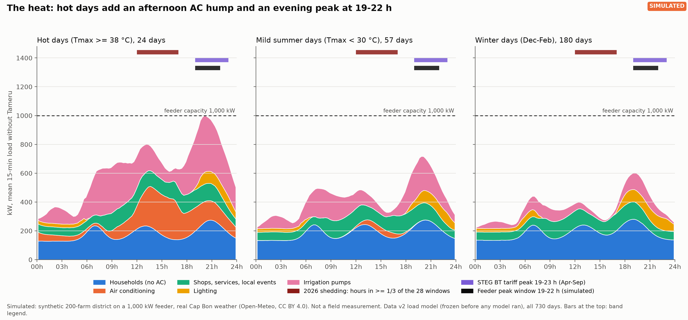
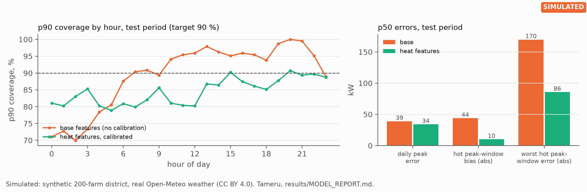
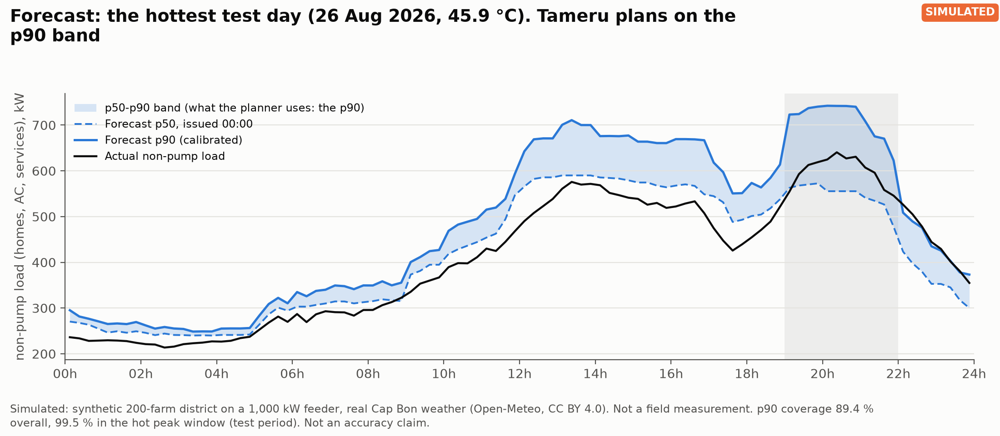
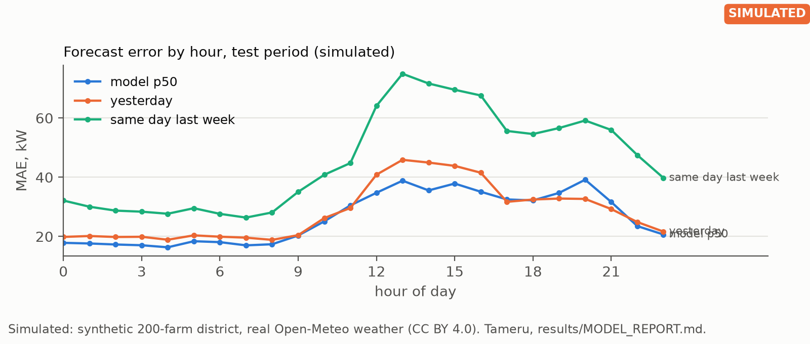
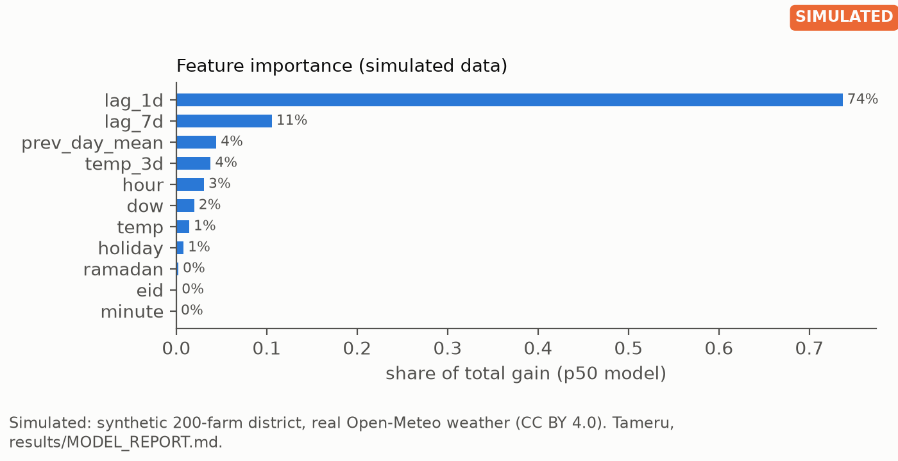
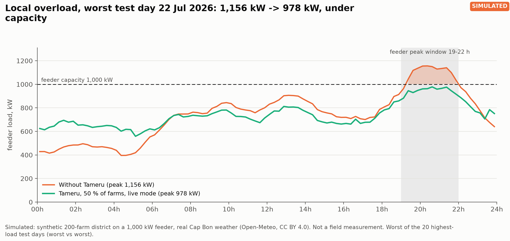
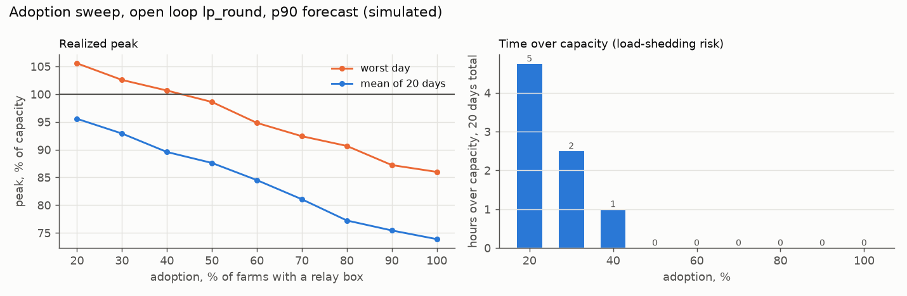
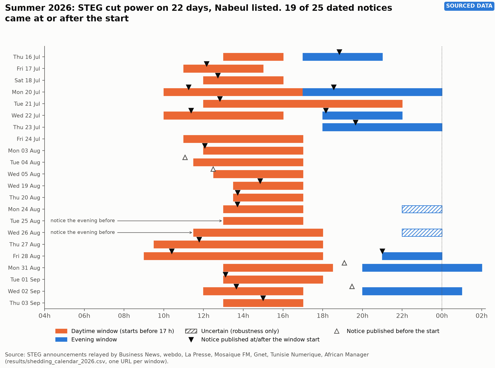
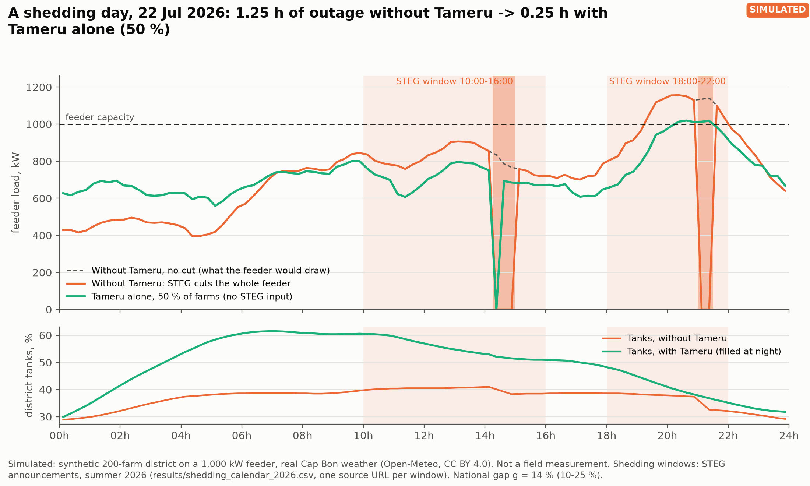
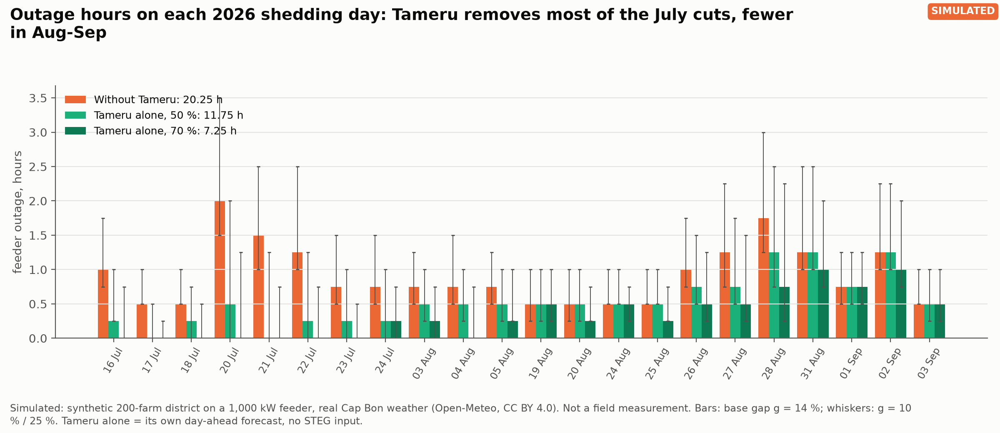

# Tameru: model report (data v2 + shedding scenario)

Every number in this report is SIMULATED. The district (200 farms, 1,000 homes, one 1,000 kW feeder in Cap Bon) is synthetic and runs on real Open-Meteo weather. These are not field measurements. Figures: deliverables/website/figures (one folder for the reports and the website).

## Summary

- Shedding scenario (section F): on the 22 documented STEG shedding days of summer 2026, feeder outage 20.25 h without Tameru -> 11.75 h with Tameru alone at 50 % of farms and 7.25 h at 70 % (national gap g = 14 %). Tameru uses only its own day-ahead forecast, no STEG notice.
- Local overload, whole test period (153 days, Jun-Oct 2026): 16 overload days and 27.75 h above capacity without Tameru -> 0 days and 0.00 h with Tameru at 50% (live mode).
- On the 20 highest-load test days at 50% adoption, mean daily peak 1,055 kW -> 873 kW (live mode, mean vs mean); time above capacity 27.75 h -> 0.00 h.
- Minimum adoption for zero overload on all 20 days (open loop, lp_round, p90): 50% of farms.
- Forecaster (test period 2026-06-01 .. 2026-10-31): p50 MAE 26.2 kW, MAPE 7.6 %; only 7 % better than 'same as yesterday'. Its value for the planner is the calibrated p90 band, which covers 89.4 % of actual values.
- Water budget (C), anomaly detection (D), tariffs and bills (E), shedding scenario (F).

## Load model v2 (why the data changed)

The first synthetic load (data v1) put the feeder peak at 17-20 h and made almost every summer evening overload. Two things in it were not realistic: the non-pump load had no afternoon air-conditioning hump, and every farmer started pumping straight to the field at 16:30-17:00, a habit we could not source. Data v2 replaces both. The non-pump load is split into households, additive air conditioning (lagged temperature, occupancy by hour, 45 % of homes), services, sunset-linked lighting and local events. Pumping habits come in five groups (early morning 20 %, morning + evening 20 %, daytime tank fill 20 %, evening 25 %, night tank fill 15 %), and pumping time is no longer irrigation time.

Protocol: the generator was tuned only against realism targets on the UNMANAGED load and frozen before any forecaster, planner or Tameru result was computed on v2 (commit 'Data v2: load model frozen'). Every model choice was then made on training / validation days, and the test period (Jun-Oct 2026) was evaluated once (tags v2-pre-test, v2-test-eval).

| Target (unmanaged load) | Result | Pass |
|---|---|---|
| T1 hot days show an afternoon AND an evening hump | two humps on 100 % of hot days | yes |
| T2 winter evening peak 18-22 h, summer later | winter median 18:45, mild summer 20:00 | yes |
| T3 heat uplift of the non-pump peak (STEG: about +30 %) | +31.4 % | yes |
| T4 high-load days are mostly hot days | 10 of 20 test days, 12 of 20 in 2025 | yes |
| T5 overload only in summer, near the known windows | 195 quarters on 29 days, 100 % Jun-Sep, 0 Nov-Mar | yes |
| S1 same district size | +1.7 % annual non-pump energy vs v1 | yes |

Result: the feeder peak window is 19-22 h (inside STEG's 19-23 h price peak), found by a fixed rule on training + validation days. One generator parameter (the evening household bump, 0.155 kW per home) sits near the bottom of its range because of one Ramadan evening (14 March 2025), which comes within 0.5 % of capacity. The local problem is smaller than in v1 and moves into the price peak.



*Mean feeder load without Tameru by component, hot / mild summer / winter days (simulated).*

## A. Base-load forecaster

Target: the district's non-pump load (homes, AC, services, lighting) at 15-min steps for the next day, issued at 00:00 with data up to 23:45 the day before. Irrigation water need is NOT forecast with ML; it comes from the FAO-56 formula.

Model in use: base feature set, LightGBM quantile regression (p50 and p90). Features, all known at issue time: hour, minute, dow, holiday, eid, ramadan, temp, temp_3d, lag_1d, lag_7d, prev_day_mean. Time split, never shuffled: train 2024-11-08 .. 2026-04-30, validation 2026-05-01 .. 2026-05-31 (early stopping: p50 155 trees, p90 311), test 2026-06-01 .. 2026-10-31 (153 days).

### Accuracy on the test period

| Forecast | MAE kW | RMSE kW | MAPE | MAPE peak window 19-22 h | Daily peak error kW | Peak timing error min |
|---|---|---|---|---|---|---|
| Model p50 | 26.2 | 36.0 | 7.6 % | 7.1 % | 39.0 | 119 |
| Same as yesterday | 28.2 | 39.0 | 8.2 % | 6.7 % | 37.6 | 124 |
| Same day last week | 45.7 | 64.0 | 13.1 % | 12.0 % | 61.7 | 162 |

| Pinball loss p50 | Pinball loss p90 | p90 coverage (target 90 %) | Skill vs yesterday | Skill vs last week |
|---|---|---|---|---|
| 13.11 | 6.68 | 89.4 % | 7 % | 43 % |

Read this honestly: on data v2 the model is only slightly better than 'same as yesterday' overall, and worse inside the peak window. We do not claim a forecasting edge. What the planner uses is the p90 band, and it is calibrated: a perfect forecast (oracle) gives the same peaks as the live mode (section B). Skill = 1 - model MAE / baseline MAE.

### Feature-set experiment: base vs heat features

The heat feature set adds temperature CHANGES known at 00:00: forecast Tmax, forecast minus yesterday's temperature at the same slot, Tmax change, cooling degree-hours above 26 °C, heat-spell length, yesterday's peak and the load two days earlier; a ratio target was also tried.

Tuning: rolling-origin cross-validation inside train + validation only (5 folds: 2025-06, 2025-07, 2025-08, 2025-09, 2026-05), 72 configurations. Best: target ratio, num_leaves 63, learning_rate 0.06, min_data_in_leaf 20, feature_fraction 0.7 (CV MAE 25.21 kW vs base 25.09 kW). The acceptance rule was fixed before any v2 model ran and uses only cross-validation predictions: CV MAE lower: NO; CV hot-window p90 coverage >= 85 %: NO; CV peak-window MAPE not worse: yes; CV heatwave MAPE not worse: yes. Decision: base features kept, heat features reported as a tried experiment (better on heat, but not on every condition). The test columns below are reported for information and could not change the choice.

| Metric | CV base | CV heat features | CV base + conformal | TEST base | TEST heat features |
|---|---|---|---|---|---|
| MAE kW | 25.1 | 25.2 | 25.1 | 26.2 | 26.4 |
| MAPE | 7.4% | 7.5% | 7.4% | 7.6% | 7.7% |
| MAPE peak window 19-22 h | 7.3% | 7.2% | 7.3% | 7.1% | 6.9% |
| p90 coverage, hot days in the peak window | 27.4% | 82.5% | 84.9% | 99.5% | 90.1% |
| p90 coverage, peak hour | 73.7% | 92.8% | 94.0% | 100.0% | 90.7% |
| MAPE heatwave days | 8.9% | 8.0% | 8.9% | 8.4% | 8.8% |
| Daily peak error kW | 43.0 | 37.5 | 43.0 | 39.0 | 34.2 |
| p90 coverage | 84.8% | 90.6% | 90.8% | 89.4% | 84.5% |

Calibration (cross-validation predictions): a per-hour split-conformal offset is added to the p90, plus 59.0 kW in the peak window on days with forecast Tmax >= 35 °C. The p50 is unchanged.



*p90 coverage by hour and p50 errors, base vs heat features (simulated).*



*Hottest test day: actual non-pump load vs p50 and the p90 band the planner uses (simulated).*

### By month

| Group | Days | MAPE model | MAPE yesterday | MAPE last week | p90 coverage |
|---|---|---|---|---|---|
| 2026-06 | 30 | 7.3 % | 8.8 % | 11.2 % | 84.5 % |
| 2026-07 | 31 | 8.7 % | 8.9 % | 16.5 % | 90.0 % |
| 2026-08 | 31 | 8.5 % | 8.5 % | 13.0 % | 90.0 % |
| 2026-09 | 30 | 7.4 % | 8.0 % | 14.6 % | 94.7 % |
| 2026-10 | 31 | 6.1 % | 6.9 % | 10.3 % | 88.0 % |

### By day type

| Group | Days | MAPE model | MAPE yesterday | MAPE last week | p90 coverage |
|---|---|---|---|---|---|
| holiday | 3 | 7.3 % | 7.9 % | 15.2 % | 93.8 % |
| weekday | 108 | 7.7 % | 8.6 % | 13.3 % | 88.3 % |
| weekend | 42 | 7.5 % | 7.2 % | 12.7 % | 92.1 % |

### Heatwave days (actual Tmax >= 35 °C)

| Group | Days | MAPE model | MAPE yesterday | MAPE last week | p90 coverage |
|---|---|---|---|---|---|
| Tmax < 35 C | 105 | 7.2 % | 8.0 % | 12.9 % | 89.6 % |
| Tmax >= 35 C | 48 | 8.4 % | 8.7 % | 13.7 % | 89.0 % |



*Mean absolute error by hour of day, test period (simulated).*

### Ablation: forecast vs perfect temperature

| Temperature input | MAE kW | MAPE |
|---|---|---|
| Temperature forecast (used) | 26.2 | 7.6 % |
| Perfect (actual) temperature | 25.4 | 7.4 % |

### Intraday correction (live loop)

During the day the rest of the forecast is scaled by actual / forecast over the last hour, bounded to ±15 %. Error on the rest of the day, before and after:

| Correction at | MAE before kW | MAE after kW | Change |
|---|---|---|---|
| 06:00 | 29.2 | 29.3 | 0 % |
| 09:00 | 31.5 | 28.8 | -8 % |
| 12:00 | 33.0 | 33.1 | 0 % |
| 15:00 | 31.9 | 30.5 | -5 % |
| 17:00 | 30.6 | 30.5 | -0 % |
| 19:00 | 29.9 | 27.4 | -9 % |



*Feature importance of the p50 model (share of total gain).*

## B. Local feeder results (backtest)

Days: the 20 highest-load test days (highest unmanaged 15-min load, Jun-Oct 2026). Each scenario plans with the information available at the time and is replayed every 15 minutes with the ACTUAL base load and what each farmer ACTUALLY did (start-time jitter, skipped days, extra water on hot days). The replay includes farmer overrides (0-10 % chance per day), the reserve rule (a tank never goes below 15 %), the float switch and the grid safety rule (above 95 % of capacity, pumps of the fullest tanks stop). Farms without Tameru pump into their own tank at their usual times.

### Scenarios at 50% adoption (totals or means over 20 days)

| Scenario | Mean peak kW | Worst peak kW | Mean % cap | Days over cap | Hours over cap | kWh above cap | Mean peak cut | Reserve viol. (15-min) | Grid-rule triggers | Pump kWh 19-22 h / day | Auto-stop min (total) | Max starts | Solve s / day |
|---|---|---|---|---|---|---|---|---|---|---|---|---|---|
| a) Unmanaged (no Tameru) | 1,055 | 1,156 | 106 % | 16 | 27.8 | 1,646 | - | 0 | 0 | 1,262 | 0 | 0 | 0.0 |
| b) Open loop, lp_round, margin 0 % | 876 | 986 | 88 % | 0 | 0.0 | 0 | 17 % | 0 | 10 | 792 | 38,148 | 3 | 0.6 |
| b) Open loop, lp_round, margin 5 % | 876 | 984 | 88 % | 0 | 0.0 | 0 | 17 % | 0 | 10 | 792 | 38,320 | 3 | 0.6 |
| b) Open loop, lp_round, margin 10 % | 875 | 984 | 88 % | 0 | 0.0 | 0 | 17 % | 0 | 8 | 791 | 38,444 | 3 | 0.6 |
| b) Open loop, milp, margin 0 % | 874 | 986 | 87 % | 0 | 0.0 | 0 | 17 % | 0 | 7 | 797 | 34,247 | 3 | 16.9 |
| b) Open loop, milp, margin 10 % | 874 | 986 | 87 % | 0 | 0.0 | 0 | 17 % | 0 | 7 | 797 | 37,516 | 3 | 15.3 |
| c) Closed loop, hourly re-plan, lp_round | 873 | 978 | 87 % | 0 | 0.0 | 0 | 17 % | 0 | 2 | 795 | 36,891 | 3 | 4.4 |
| d) Oracle forecast, lp_round (upper bound) | 873 | 980 | 87 % | 0 | 0.0 | 0 | 17 % | 0 | 8 | 791 | 38,093 | 3 | 0.7 |

Open loop: one plan at 00:00 from the p90 forecast. Closed loop (live mode): re-plan every hour with actual tank levels and the intraday-corrected forecast. Oracle: plan with the actual base load. MILP is the exact reference solver; lp_round is the fast main mode.



*Worst test day: feeder load without Tameru vs Tameru 50 %, live mode (simulated).*

### Adoption sweep (open loop, lp_round, p90, margin 0 %)

| Adoption | Mean peak kW | Worst peak kW | Days over cap | Hours over cap | kWh above cap | Mean peak cut | Grid-rule triggers | Reserve viol. |
|---|---|---|---|---|---|---|---|---|
| 20% | 956 | 1,056 | 3 | 4.75 | 150 | 9 % | 51 | 0 |
| 30% | 929 | 1,026 | 2 | 2.50 | 32 | 12 % | 39 | 0 |
| 40% | 896 | 1,006 | 1 | 1.00 | 4 | 15 % | 23 | 0 |
| 50% | 876 | 986 | 0 | 0.00 | 0 | 17 % | 10 | 0 |
| 60% | 845 | 948 | 0 | 0.00 | 0 | 20 % | 0 | 0 |
| 70% | 811 | 924 | 0 | 0.00 | 0 | 23 % | 0 | 0 |
| 80% | 772 | 907 | 0 | 0.00 | 0 | 27 % | 0 | 0 |
| 90% | 754 | 872 | 0 | 0.00 | 0 | 29 % | 0 | 0 |
| 100% | 739 | 860 | 0 | 0.00 | 0 | 30 % | 0 | 0 |

Minimum adoption for zero overload on all 20 days: 50% of farms (every higher level is also overload-free).



*Hours above capacity and shedding outage hours vs share of farms equipped (simulated).*

### Planning margin at higher adoption (open loop, lp_round, p90)

| Adoption | Margin | Mean peak kW | Worst peak kW | Days over cap | Hours over cap | Grid-rule triggers | Reserve viol. |
|---|---|---|---|---|---|---|---|
| 70% | 0% | 811 | 924 | 0 | 0.00 | 0 | 0 |
| 70% | 5% | 811 | 922 | 0 | 0.00 | 0 | 0 |
| 70% | 10% | 812 | 930 | 0 | 0.00 | 0 | 0 |
| 80% | 0% | 772 | 907 | 0 | 0.00 | 0 | 0 |
| 80% | 5% | 771 | 900 | 0 | 0.00 | 0 | 0 |
| 80% | 10% | 773 | 899 | 0 | 0.00 | 0 | 0 |

The planner already uses the p90, so an extra margin changes almost nothing (margin 0 was chosen on training days).

### Robustness: three fault types (closed loop)

Fault rates are ASSUMPTIONS, not measurements: pump failure 1%, stuck/stale tank sensor 1%, communication loss 2% per farm per day, sensor noise ±3% of tank volume. Pump failures last 2-8 h, stuck sensors 2-12 h, communication loss 1-6 h; faults are seeded per day, so every scenario of a day sees the same faults. A farm without a link runs its local failsafe (pump on below 30 %, off at 90 %).

| Case | Faults | Mean peak kW | Worst peak kW | Days over cap | Hours over cap | kWh above cap | Reserve viol. (15-min) | Unmet water m³ | Fault quarters | Failsafe pump kWh 19-22 h | Grid-rule triggers |
|---|---|---|---|---|---|---|---|---|---|---|---|
| Unmanaged | no | 1,055 | 1,156 | 16 | 27.75 | 1,646 | 0 | 0 | 0 | 0 | 0 |
| Unmanaged | yes | 1,054 | 1,151 | 16 | 27.75 | 1,614 | 0 | 616 | 2615 | 0 | 0 |
| Closed loop 50% | no | 873 | 978 | 0 | 0.00 | 0 | 0 | 0 | 0 | 0 | 2 |
| Closed loop 50% | yes | 878 | 982 | 0 | 0.00 | 0 | 544 | 446 | 2615 | 42 | 3 |
| Closed loop 70% | no | 814 | 945 | 0 | 0.00 | 0 | 0 | 0 | 0 | 0 | 1 |
| Closed loop 70% | yes | 818 | 941 | 0 | 0.00 | 0 | 879 | 341 | 2615 | 42 | 0 |

First fault test, three fault types (the five-type evaluation follows). Same faults, with and without Tameru (assumption-based): over 20 days, 446 m³ of irrigation water went unmet with Tameru at 50% adoption, against 616 m³ without Tameru, because stored water keeps fields irrigated while a pump is broken. Time over capacity: 0.0 h with Tameru vs 27.8 h without. Five-type evaluation, all five fault types (leak and dry run added), same seeded draws in every scenario, anomaly detector on: unmet irrigation water 1,303 m³ without Tameru, 754 m³ at 50 % and 612 m³ at 70 %; time over capacity 27.75 h, 0.00 h and 0.00 h. In the model, leaks only cost water on tank-fed farms (without Tameru the tank is bypassed), which makes this comparison conservative for Tameru.

## C. Water budget

Per farm and day: crop need = FAO-56 (Kc x ET0 - effective rain) / efficiency x area; budget = 110 % of that need (fixed in advance). In enforced mode, Tameru caps each adopting farm's daily pumping at 110 % of its FAO-56 crop need and never below that need: a reserve top-up still runs while the field has not had its crop need. Advisory mode only warns. Tameru controls the pump, not the field valve, so excess irrigation is curtailed when the tank runs dry after the crop need has been delivered.

| Scenario (20 test days, mean per day) | Pumped m³ | Above budget m³ | Water saved (curtailed excess) m³ | Unmet crop need m³ | Energy saved kWh | CO₂ avoided kg | kWh/m³ | kWh/ha | Mean peak kW | Hours over cap (20 days) |
|---|---|---|---|---|---|---|---|---|---|---|
| No Tameru | 34,676 | 3,390 | 0 | 0.0 | 0 | 0 | 0.168 | 11.96 | 1,055.1 | 27.75 |
| Closed loop 50 %, budget off | 34,496 | 3,373 | 0 | 0.0 | 0 | 0 | 0.167 | 11.85 | 873.4 | 0.00 |
| Closed loop 50 %, budget enforced | 33,079 | 1,962 | 395 | 0.0 | 66 | 27 | 0.167 | 11.37 | 870.1 | 0.00 |
| Closed loop 70 %, budget off | 34,679 | 3,365 | 0 | 0.0 | 0 | 0 | 0.167 | 11.90 | 813.7 | 0.00 |
| Closed loop 70 %, budget enforced | 32,576 | 1,286 | 586 | 0.0 | 101 | 41 | 0.167 | 11.18 | 797.6 | 0.00 |

Crop need 32,935 m³/day. Without the budget, the closed loop pumps -0.5 % more than no Tameru (reserve top-ups, end-of-day refill). With the budget enforced it pumps 4.6 % less than no Tameru, with 0.0 m³/day of unmet crop need.

Water saved at 50 %: 395 m³/day (conservative: water asked for above the crop need that was not supplied) up to 1,418 m³/day (the pumping cut vs budget off). Each replayed day restarts at the same tank level, so part of the pumping cut is tank drawdown that a real farm would repay the next day. The true long-run saving lies in this range; we quote the conservative figure.

Over-pumping that remains with the budget enforced comes 96 % from farms not connected to Tameru, 4 % from farmer overrides and about 0 % from capped adopters (calibration days).

CO₂: only from the energy of water that was not pumped, x 404 gCO₂/kWh (IFI Dataset of Default Grid Factors v.2.0, IFI Technical Working Group on GHG Accounting (July 2019), Tunisia, combined margin grid emission factor, column 'firm energy / energy efficiency': 404 gCO2/kWh; 2019 dataset). Moving pumping in time saves no energy and is not counted as CO₂ avoided. kWh/m³ and kWh/ha are energy performance indicators aligned with ISO 50006 vocabulary (not a compliance claim).

Calibration (summer-2025 training days, used to design the budget before the test): pumped 34,509 -> 33,216 m³/day at 50 %, curtailed excess 316 m³/day, unmet crop need 0.0 m³/day. The test-day table above is the single final evaluation.

## D. Anomaly detection

The detector sees only what a real backend sees: measured tank level, pump power, its own commands, the planned irrigation and online status. It never sees the fault labels. Method: a physics residual (measured level change minus pump inflow at the measured power share, plus planned irrigation) with per-farm rules: a one-sided CUSUM for leaks on quiet quarters, dry run (15-60 % of rated power and the level not rising), pump failure (commanded on, no power), stuck sensor (a noisy reading that stops changing while the pump or the irrigation runs) and communication loss (60-s heartbeat). Dry run and pump failure send a pump stop (1-h lockout, then retry); leak and stuck sensor are alerts only. Each alert has a type, a confidence (the training precision of its type), a one-sentence explanation and a suggested action.

Faults injected at ASSUMED rates per farm per day: leak 2 % (0.5-3 m³/h, 12-72 h), dry run 2 % (1-6 h, 40 % of rated power, no water), plus the pump failure, stuck sensor and communication loss rates of section B. Thresholds were calibrated on the 20 worst-load training days of summer 2025 (buf 2, ext 0.5, drift 0.0, h 0.14, clip 0.08, n_dry 1, n_pf 1, n_stuck 1) and the test days were evaluated once.

| Fault | Episodes | Observable | Alerts | Precision | Recall (observable) | Recall (all) | F1 (observable) | F1 (all) | Median delay min |
|---|---|---|---|---|---|---|---|---|---|
| leak | 30 | 30 | 19 | 0.53 | 0.33 | 0.33 | 0.41 | 0.41 | 398 |
| dry_run | 40 | 23 | 18 | 1.00 | 0.78 | 0.45 | 0.88 | 0.62 | 45 |
| pump_failure | 22 | 10 | 12 | 0.83 | 1.00 | 0.45 | 0.91 | 0.59 | 105 |
| stuck_sensor | 18 | 10 | 9 | 1.00 | 0.90 | 0.50 | 0.95 | 0.67 | 180 |
| comm_loss | 44 | 44 | 44 | 1.00 | 1.00 | 1.00 | 1.00 | 1.00 | 0 |
| all except comm_loss | 110 | 73 | 58 | 0.81 | 0.64 | 0.43 | 0.72 | 0.56 | - |

Observable = the fault could show up in telemetry (for example, a pump failure while the pump was never commanded on cannot be seen). False alarms (alerts matching no fault): 0.44 per 100 monitored farm-days (1,807 farm-days). comm_loss scores 1.00 by construction (a heartbeat rule), so the aggregate without it is the meaningful one. Repeat alerts (same farm and type within 2 h) are not counted.

Weak spot: slow leaks. The level sensor carries ±3 % noise, which hides a leak of 0.5-3 m³/h for hours (median delay 398 min, recall 0.33). A better level sensor is the hardware fix.

Safety-loop trade-off (test days): dry-run energy 126.8 -> 87.5 kWh, but unmet irrigation water 752 -> 754 m³ (the 1-h lockout outlasts some dry runs, and two pump-failure alerts that matched no pump failure stopped pumps). The feeder peak is unchanged.

Tried experiment, not combined: an IsolationForest on hourly residual features (type-agnostic). On the test days: precision 0.05, recall 0.06, F1 0.05, 15.9 false alarms per 100 farm-days. The rule fixed before the test (add it only if the union beats physics alone on the training days) said no, so the physics detector is the result.

## E. Tariff context and pump bills

Tunisian irrigation customers on low voltage (BT) are offered STEG's three-period tariff (in force since 1 May 2022): day 140, evening peak 391, night 116 mill/kWh before tax. Summer hours (April-September): day 08-19, peak 19-23, night 23-08. The flat irrigation tariff (184 mill/kWh) is closed to new contracts. Our simulated feeder peaks at 19-22 h, inside STEG's 19-23 h price peak, so shaving the local peak and lowering the bill point the same way. In summer 2026 STEG's rotating shedding windows covered mostly the afternoon and the evening (section F).

| Tariff (bills of the existing schedules, 20 test days) | Setting | Adopters | Median saving TND | p10 TND | p90 TND | Farms whose bill goes up |
|---|---|---|---|---|---|---|
| steg bt 3p ttc | budget off | 94 | 21.75 | -3.89 | 109.83 | 18 |
| steg bt 3p ttc | budget enforced (recommended) | 94 | 32.05 | 2.37 | 113.58 | 3 |
| legacy flat ttc | budget off | 94 | -3.39 | -13.11 | 19.22 | 68 |
| legacy flat ttc | budget enforced (recommended) | 94 | 4.33 | -4.79 | 33.25 | 22 |
| proposed cpp ttc | budget off | 94 | 83.43 | -3.25 | 327.30 | 16 |
| proposed cpp ttc | budget enforced (recommended) | 94 | 88.88 | 2.68 | 331.46 | 3 |

The farmer bill saving is modest (median per farm over the 20 test days). Tameru's main value is grid relief, water saved and, under a critical-peak tariff, rebates.

Saving per adopting farm over the 20 days, closed loop 50 % vs no Tameru, tax included (VAT 7 % + 10 mill/kWh). Adopters' pumping in 19-23 h: 26.5 % -> 7.9 % of their kWh; in 23-08 h: 21.9 % -> 65.3 %. proposed_cpp is a PROPOSAL, what STEG or the regulator could introduce: steg_bt_3p + 400 mill/kWh in 19-22 h on forecast critical days (reserve top-ups exempt) - 1,000 mill per kW shaved vs the farm's usual pumping. Its parameters are assumptions fixed in advance. Fixed charges are ignored (same in every scenario).

### Critical windows (STEG alert input), training days only

An optional planner input forbids adopters' pumping in given windows (reserve top-ups exempt). Tested only on the 20 summer-2025 training days with 22:00-01:00 (one of STEG's announced 2026 windows). It is off by default (it raised the mean peak by 7.8 %), so sections B-E do not use it; the shedding scenario (F) sets its own windows.

| Closed loop 50 % | Adopters' kWh in 22-01 h | Mean peak kW | Hours over cap | Unmet crop need m³ |
|---|---|---|---|---|
| without window | 21.2 % | 859.1 | 0.00 | 0.0 |
| with 22:00-01:00 | 1.2 % | 926.5 | 0.00 | 0.0 |

## F. Shedding scenario: STEG rotating cuts, summer 2026

In summer 2026 STEG cut power in rotation to avoid a national blackout: 28 announced windows on 22 days between 16 July and 3 September, Nabeul / Cap Bon listed on 27 (results/shedding_calendar_2026.csv, one source URL per window). 19 of the 25 dated notices were published at or after the window had started. This module passes the national shortfall down to our feeder: without Tameru, STEG must shed g of the feeder's baseline energy in each window and does it with one rotating cut of g x window length (the whole feeder dark: homes, shops, pumps).

National gap g = 1 - available supply / peak demand: base 14 % (Le Temps, 26 July: 4,300 / 5,000 MW), low 10 %, high 25 %. Only the 5,000 MW demand is a STEG figure (CEO, TAP); the supply figures come from a deputy and the press. The resulting cuts (30-90 min per window at base g) are conservative: residents reported 4-6 h.

Tameru alone (mode A, the main result) uses no STEG information: at 00:00 it flags a risk day when forecast Tmax >= 38 °C, keeps equipped farms' pumping out of the 12 hours with the highest forecast p90 load and pre-fills tanks at night. Mode B adds each announced window from its publication time (comparison only). Tameru's demand reduction in the window shortens the cut: remaining cut = (residual shortfall / required shedding) x the no-Tameru cut, rounded up to 15 min. Design frozen before the test (tag shed-pre-test), single evaluation (tag shed-test-eval); budget enforced, 50 % and 70 % adoption.

| Windows | g | Without Tameru h | Tameru alone, 50 % h (windows at 0 h) | Tameru + STEG notice, 50 % h (windows at 0 h) | Tameru alone, 70 % h (windows at 0 h) | Tameru + STEG notice, 70 % h (windows at 0 h) | Normal loop, no shedding mode, 50 % h (windows at 0 h) |
|---|---|---|---|---|---|---|---|
| daytime (21) | low 10 % | 11.50 | 5.75 (6) | 5.75 (6) | 3.50 (10) | 3.00 (11) | 5.50 (7) |
| daytime (21) | base 14 % | 16.00 | 9.75 (2) | 9.50 (2) | 6.25 (7) | 5.75 (8) | 10.00 (1) |
| daytime (21) | high 25 % | 29.25 | 22.75 (0) | 22.75 (0) | 18.50 (0) | 18.00 (0) | 23.00 (0) |
| evening (7) | low 10 % | 3.50 | 1.25 (4) | 1.25 (4) | 0.75 (4) | 0.75 (4) | 1.25 (4) |
| evening (7) | base 14 % | 4.25 | 2.00 (2) | 2.00 (2) | 1.00 (4) | 1.00 (4) | 2.75 (0) |
| evening (7) | high 25 % | 8.00 | 5.75 (0) | 5.75 (0) | 4.00 (0) | 3.75 (0) | 6.25 (0) |
| all (28) | low 10 % | 15.00 | 7.00 (10) | 7.00 (10) | 4.25 (14) | 3.75 (15) | 6.75 (11) |
| all (28) | base 14 % | 20.25 | 11.75 (4) | 11.50 (4) | 7.25 (11) | 6.75 (12) | 12.75 (1) |
| all (28) | high 25 % | 37.25 | 28.50 (0) | 28.50 (0) | 22.50 (0) | 21.75 (0) | 29.25 (0) |

- Base g: 20.25 h -> 11.75 h at 50 % and 7.25 h at 70 %; days with no cut left 2 (50 %) and 8 (70 %) of 22.
- Tameru alone gets 96-97 % of what STEG's notices would add. Most of the gain comes from normal planning: the plain loop already brings it to 12.75 h at 50 %; the shedding mode adds about 1 h.
- Afternoon windows are hard (little pumping to stop); evening windows are where Tameru helps most. At high g (25 %) no window reaches 0 h.
- Unmet crop need on these days: 95 m³ without Tameru, 0 with it.
- Risk flag at 38 °C: 13 hits, 9 misses (the cooler Aug-Sep days), 12 false alarms; false alarms cost almost nothing (no extra pumping, no overload, a small bill increase from pre-filling at the day rate).
- Side effect: at 50 % the shifted pumping creates 105 min of local overload inside windows on 20-22 July (max 1,019 kW); none at 70 %.
- Windows after midnight are cut at 24:00 (3 h dropped). Water and tank numbers exist for base g only.



*STEG shedding calendar, summer 2026 (sourced data).*



*22 July 2026: the cut without Tameru and the managed feeder (simulated).*



*Outage hours per shedding day (simulated).*

## Data, method and limitations

- Data: 730 days (2024-11-01 to 2026-10-31). Open-Meteo historical weather for 36.68 N, 10.58 E (CC BY 4.0); hottest hour 45.9 °C on 2026-08-26. Everything else is synthetic: farms (sectors A-D), crops (FAO-56 Kc curves), pumps, tanks, irrigation efficiencies, farmer behaviour and the non-pump load (data v2, frozen before any model ran). Tank and pump sizes and fault rates are assumptions.
- The forecaster partly re-learns the generator's patterns, so its accuracy here is not proof of accuracy on a real feeder. With real utility data the same pipeline is retrained and re-scored.
- Water need is the FAO-56 formula, never ML. Only the non-pump load is forecast with ML; scheduling is optimisation.
- Pump schedules use 30-min slots, at most 3 starts per day, runs of at least 1 h; the feeder is checked every 15 min.
- Known limitation: the fast planner (lp_round) ends the day with 22-38 m³ less water in the district's tanks than the exact MILP (objective 2.3-8.0 % worse on 5 training days); peaks are within 1 %. Hourly re-planning catches most of it up. Not changed (frozen protocol).
- Faults are simulated with ASSUMED rates. Real rates must come from field pilots.
- Not modelled: network losses, sector-wide communication outages, slow sensor drift. Tariffs enter the planner only as a secondary cost (STEG three-period prices); the main objective is the peak.

### Reproduce

```
.\.venv\Scripts\Activate.ps1
cd tameru_data
python generate_db.py
python forecast.py
python backtest.py
python shedding.py --eval   # once; refuses to overwrite
python report.py
python export_site.py
python site_figures.py
```
